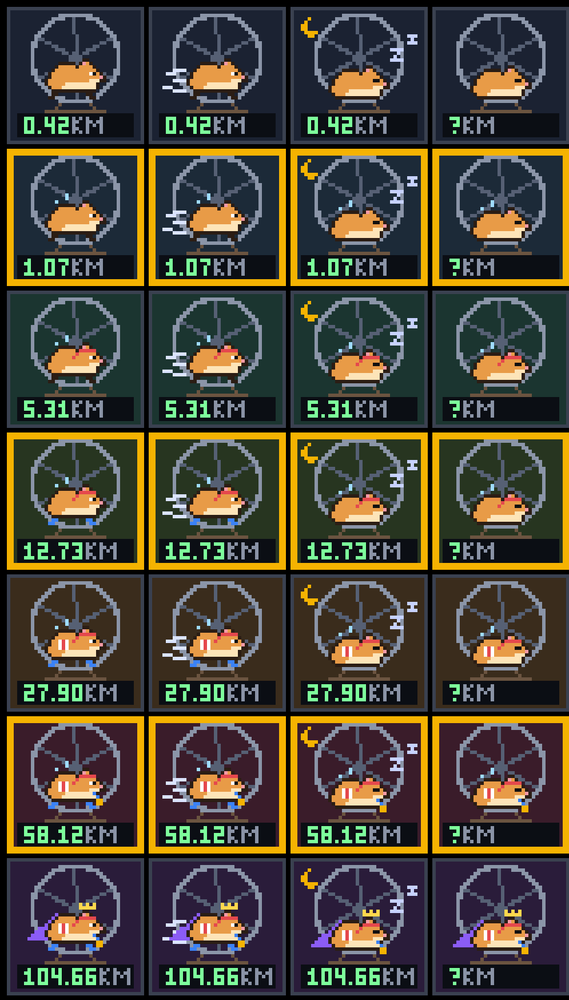

# Squeek Odometer

A free, fully on-chain odometer for **Squeektoshi**, the hamster whose wheel powers
[Squeekchain](https://squeekchain.com). Every token remembers the wheel's settled work at the moment it was minted
and shows how far he has run since, read live from SqueekCore on Sepolia. It naps when he naps, gets the zoomies
when he does, and earns gear as the kilometres add up. Squeek holders get a gold frame.

Built for the [Squeekchain Genesis Code Lane](https://squeekchain.com/genesis/code), in the "dynamic NFTs that
evolve with the hamster" category. Testnet only. Not affiliated with Squeekchain.



## How a token reads the wheel

Everything is computed in `tokenURI` on every call; the only thing stored per token is its starting point.

| What | How |
|---|---|
| Distance | SqueekCore `cumulativeWork` now minus at mint, × **887 mm**. One work unit is one accepted magnet passage, i.e. one wheel turn. The device estimates distance from a fixed wheel circumference; Squeekchain's API lifetime figures (22,789,368 mm over 25,701 units) give 886.7 mm, live speed/RPM readings about 880 mm. |
| Status | Work settled in the last three SqueekCore rounds (30 minutes, `roundPage`): none is **napping**, under 1,500 is **jogging**, 1,500 or more is **zoomies**. If SqueekCore cannot be read, **unknown**. |
| Stage | Newbie, Warm-up at 1 km, Jogger 5, Runner 10, Racer 25, Marathoner 50, Legend 100. Each stage adds gear: a sweat drop, a headband, shoes, a race bib, a medal, then a crown and cape. |
| Gold frame | The token's current owner holds a Squeek (`SqueekNFT.balanceOf > 0`) or has Squeeks deposited (`SqueekStaking.accountPower` NFT power > 0). |

Odometers count settled work only, so they move a few minutes after the wheel does.

## Contract

`src/SqueekOdometer.sol`, an OpenZeppelin ERC-721 with ERC-4906 support.

- `mint()`: free, one per wallet (`idOf` remembers the wallet's token even after it is sent away), 9,999 in total.
  Reverts if SqueekCore cannot be read, so every token starts from a real reading.
- `reading(id)`: the live values behind a token. `tokenURI(id)`: JSON with an SVG image, both base64 data URIs.
- No owner, no admin, no pause, no upgrade, nothing payable, no withdrawal.
- Every Squeekchain read is a gas-capped static call that copies a fixed number of words, so a broken or hostile
  dependency can only fail its own read; `tokenURI` never reverts for an existing token.
- The constructor takes the three Squeekchain addresses and reverts outside Sepolia (local chain 31337 is allowed for
  tests). It makes no external calls.

Squeekchain contracts used (Sepolia, release `core-sepolia-20261103`,
[deployments](https://docs.squeekchain.com/developers/#deployments)):

| Contract | Address |
|---|---|
| SqueekCore | `0xFD6C166D4B8E2962E65746a13e5a0797CD4dE0c4` |
| SqueekNFT (Squeeks) | `0xC4C7982657f00509548F3a3a41db7FA439a6856B` |
| SqueekStaking | `0x50fd1780526C3186A0c037c7622203bC4fb611ca` |

`launch.json` carries the same arguments for an IMD deployment.

## Art

A 40×40 pixel scene in SVG, drawn on chain. `tools/sprites.py` builds every layer (wheel, the hamster running and
napping, each stage's gear, moon and zzz, speed lines, a 3×5 odometer font) and writes them to
`src/art/Sprites.sol` as run data; `src/art/OdometerArt.sol` turns each color group into one SVG path through a
write-once buffer, so a render costs linear gas.

```sh
python tools/sprites.py                                      # regenerate Sprites.sol (and Pillow previews)
FOUNDRY_PROFILE=gallery forge script script/Gallery.s.sol    # the contract's own SVG for every combination
```

## Build and test

Solidity 0.8.26 (`evm_version = "cancun"`), optimizer on, `bytecode_hash = "none"`. OpenZeppelin Contracts 5.7.0 and
forge-std 1.16.2 are vendored as plain files in `lib/`: no submodules, no FFI, no network for the default tests.

```sh
forge build
forge test                       # mint rules, distance/stage/status math (fuzzed), holder detection, failing
                                 # dependencies, art and metadata
FOUNDRY_PROFILE=fork forge test  # against the real Squeekchain contracts on Sepolia at a pinned block
```

## Site

`site/` is one static page with no build step and no libraries: connect a wallet, mint, see your odometer, the
wheel's live state from [Squeekchain's public API](https://docs.squeekchain.com/developers/api/), and the latest
mints. Reads go through a public Sepolia RPC. The contract address comes from `site/config.js`, or from
`imd-deployment.json` next to the page when IMD hosts it.

## License

MIT. OpenZeppelin Contracts and forge-std keep their own licenses in `lib/`.
